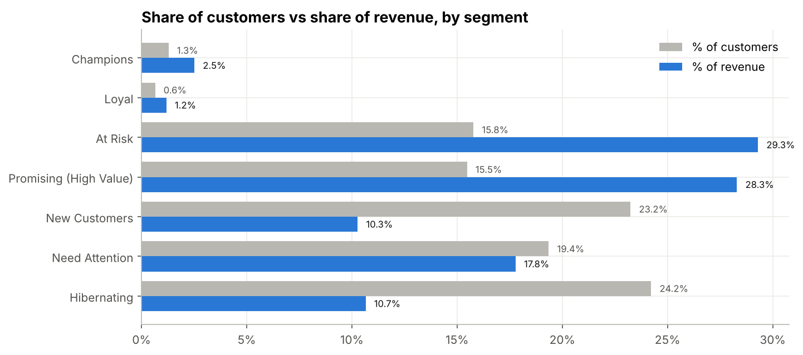
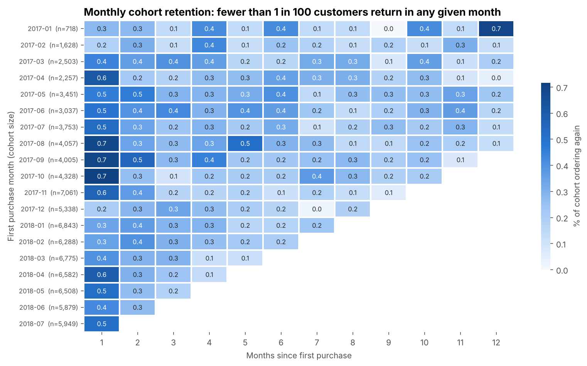

# E-commerce Customer Segmentation (RFM + Cohort Retention)

Customer analysis of ~96K real orders from Olist, a Brazilian e-commerce marketplace. I wanted to answer three questions:

1. Which customers bring in the most money?
2. Which ones are we about to lose?
3. Do customers come back after their first order?

**Tools:** SQL (SQLite), Python (pandas, NumPy), Matplotlib, Seaborn, Jupyter

---

## Key findings

| # | Finding |
|---|---|
| 1 | Only **3.0%** of customers ever placed a second order. In any month after the first purchase, less than **0.5%** of a cohort comes back. |
| 2 | The top **20%** of customers generate **53.5%** of revenue. |
| 3 | **At Risk** customers are 15.8% of the base but **29.3%** of revenue. They spent ~1.9x the average customer and haven't ordered in over a year. |
| 4 | **14,404 "Promising"** customers made one big recent purchase. Getting them to a second order is the cheapest growth lever. |





---

## Approach

**1. Data cleaning (SQL)**
- Kept only `delivered` orders from Jan-2017 to Aug-2018. The months before and after have very few orders.
- Used `customer_unique_id` instead of `customer_id`. In this dataset `customer_id` is new for every order, so using it would make every customer look like a one-time buyer.
- Summed `payment_value` per order, since one order can be paid in parts (voucher + card).

**2. RFM scoring**
- Recency = days since last order (reference date 2018-09-01)
- Frequency = number of orders
- Monetary = total spend
- R and M are scored 1 to 5 with `NTILE(5)` in SQL.
- **F is scored with fixed rules (1 order / 2 orders / 3+) instead of quintiles.** 97% of customers have exactly 1 order, so quintiles would give different scores to customers with identical behaviour.

**3. Segmentation:** rule-based segments (Champions, Loyal, At Risk, Promising, New, Need Attention, Hibernating). The rules are listed in the notebook.

**4. Cohort analysis:** customers are grouped by first-purchase month, and I track what % ordered again in each later month.

---

## Recommendations

| Segment | Action |
|---|---|
| Champions / Loyal | VIP perks, early access, referral programme |
| At Risk | Personalised win-back offer. High past spend gives the best return here |
| Promising (High Value) | Post-purchase follow-up + discount on 2nd order within 30 days |
| New Customers | Onboarding emails, small coupon for 2nd purchase |
| Hibernating | Low-cost channels only, no paid budget |

---

## Project structure

```
├── data/                     raw Olist CSVs (orders, customers, payments)
├── notebooks/
│   └── customer_segmentation.ipynb   full analysis
├── sql/
│   └── rfm_analysis.sql      all SQL queries used
├── images/                   charts
├── outputs/                  final tables (customer segments, cohort table)
└── requirements.txt
```

## How to run

```bash
git clone <this-repo-url>
cd ecommerce-customer-segmentation
pip install -r requirements.txt
jupyter notebook notebooks/customer_segmentation.ipynb
```

## Limitations / next steps
- Monetary includes freight charges.
- Recent cohorts (2018) have only a few months of history.
- Next: add product category and state to each segment, build a Power BI dashboard on `outputs/`, and train a model to predict which customers will make a second purchase.

## Data source
[Brazilian E-Commerce Public Dataset by Olist](https://www.kaggle.com/datasets/olistbr/brazilian-ecommerce) (Kaggle, CC BY-NC-SA 4.0). Only the 3 files needed for this analysis are included.
